<div align="center">

# ⚡ Executive Text-to-SQL AI Copilot
### Production Multi-Tenant Analytical Intelligence Engine with AST Security Guardrails, Speech-to-Text, and Executive Summarization

[](https://python.org)
[](https://fastapi.tiangolo.com)
[](https://groq.com)
[](https://openai.com)
[](https://github.com/tobymao/sqlglot)
[](https://mohammedtahawy.github.io/Text-to-SQL/)

<br/>

> 🌐 **Live Interactive Website:** **[https://mohammedtahawy.github.io/Text-to-SQL/](https://mohammedtahawy.github.io/Text-to-SQL/)**  
> Anyone can open this link to test queries, view synthesized SQL with tenant isolation, live charts, and export CSV directly in their browser without installing anything!

[](https://docker.com)
[](https://opensource.org/licenses/MIT)

**Engineered by [Mohamed Tahawy](https://github.com/MohammedTahawy)**  
*AI & Enterprise Systems Architect*

[Live Demo](#-interactive-demo--visual-interface) • [System Architecture](#-system-architecture) • [Security & AST Guardrails](#-enterprise-ast-security-guardrail) • [Quickstart Guide](#-quickstart-guide) • [API Reference](#-api-endpoints)

---

</div>

## 📌 Executive Summary & Value Proposition

Enterprise ERP databases often consist of hundreds of unindexed, legacy tables with cryptic column names, making self-serve executive analytics impossible without dedicated BI engineers. Furthermore, typical LLM Text-to-SQL solutions suffer from:
1. **Critical Data Breaches**: No strict multi-tenant isolation, risking customer data leaks between subsidiaries.
2. **SQL Injection Vulnerabilities**: Raw user prompts injected into databases with destructive DDL/DML risks.
3. **Hallucinated Schemas**: Models guessing nonexistent tables, joins, and aggregates.

**Executive Text-to-SQL AI Copilot** solves these enterprise hurdles through a curated **Semantic Abstraction Layer**, **Abstract Syntax Tree (AST) Security Guardrails**, **Zero-Latency Groq Inference**, and a modern **Voice-Enabled Executive Dashboard**.

---

## 🚀 Key Architectural Capabilities

### 🎙️ 1. Ultra-Low Latency Speech-to-Text (Arabic & English)
- Integrated with **Groq Whisper Large v3 Turbo** processing spoken voice queries in **< 0.5 seconds**.
- Fully supports Egyptian, Gulf, and Modern Standard Arabic enterprise business dialects alongside fluent English.

### 🛡️ 2. AST-Powered Security & Multi-Tenant Guardrails
- **Read-Only Enforcement**: Intercepts queries at the Abstract Syntax Tree level via `sqlglot`. Blocks `INSERT`, `UPDATE`, `DELETE`, `DROP`, `ALTER`, `TRUNCATE`, and stacked multi-statements `;`.
- **Dynamic Tenant Isolation**: Automatically injects mandatory tenant filters (`Cmp_No = :tenant_id` and `Brn_No = :branch_id`) into the AST WHERE clause, making tenant bypassing mathematically impossible.
- **Whitelist Enforcement**: Whitelists 6 curated analytical views (`v_sales_invoices`, `v_sales_invoice_items`, `v_inventory_stock`, `v_customers_overview`, `v_salesmen_overview`, `v_crm_leads_overview`), completely shielding underlying raw relational schemas.

### 🧠 3. Natural Language to SQL Synthesis
- Synthesizes complex aggregations, date period filtering (e.g., *last month*, *year-to-date*), top performers, branch comparisons, and cross-company audits.
- Delivers end-to-end execution (STT → SQL Generation → AST Sanitization → DB Query → Executive Summary) in **under 1.5 seconds**.

### 📊 4. Executive Summarization & Instant Data Visualization
- Returns business takeaways with key KPIs highlighted (Total Invoiced, Outstanding Debt, Top Contributors).
- Dynamically generates interactive **Chart.js** bar, line, and doughnut charts directly alongside verified tabular data and 1-click UTF-8 CSV exports.

### 💬 5. Autonomous WhatsApp Sales & CRM Agent
- Autonomous customer-facing agent capable of querying real-time inventory balances, verifying unit pricing, and qualifying sales leads directly into the CRM database via OpenAI/Groq function calling.

---

## 🏛️ System Architecture

```mermaid
sequenceDiagram
    autonumber
    actor Executive as 👔 Executive / Decision Maker
    participant UI as 🖥️ Executive Web UI / Voice
    participant API as ⚡ FastAPI Orchestrator
    participant Whisper as 🎙️ Groq Whisper v3 Turbo
    participant LLM as 🧠 Groq LLM (gpt-oss-120b)
    participant Guardrail as 🛡️ AST Guardrail (sqlglot)
    participant DB as 🗄️ Enterprise Database Engine

    Executive->>UI: Speaks voice query or types business question
    alt Voice Query
        UI->>API: Multipart Audio (WAV / WebM)
        API->>Whisper: Speech-to-Text Transcription
        Whisper-->>API: Transcribed Text Query
    else Text Query
        UI->>API: Natural Language Question
    end

    API->>LLM: Semantic Layer Prompt + Whitelisted Views Schema
    LLM-->>API: Raw Generated SQL Query

    rect rgb(30, 41, 59)
        Note over API,Guardrail: AST Security & Tenant Isolation Inspection
        API->>Guardrail: Validate Query AST
        Guardrail->>Guardrail: Block DDL/DML & Multi-statements (;)
        Guardrail->>Guardrail: Enforce Whitelisted Views Only
        Guardrail->>Guardrail: Inject Tenant Isolation (WHERE Cmp_No = :cmp_no)
        Guardrail-->>API: Sanitized, Secure Parameterized SQL
    end

    API->>DB: Execute Read-Only Parameterized Query
    DB-->>API: Verified Tabular Records
    API->>LLM: Synthesize Executive Takeaways & Insights
    LLM-->>API: Business Summary
    API-->>UI: JSON Payload (Records, SQL Telemetry, Summary, Chart Specs)
    UI->>Executive: Render Executive KPIs + Verified Table + Interactive Chart
```



---

## 🛡️ Enterprise AST Security Guardrail

Traditional regex-based SQL filters fail when queries contain subqueries, comments, or nested joins. Our solution parses the SQL into an **Abstract Syntax Tree (AST)** before execution:

```python
# app/modules/text_to_sql/guardrails.py
import sqlglot
from sqlglot import exp

class SQLSecurityGuardrail:
    """Enforces mathematical read-only guarantees and tenant isolation."""
    
    ALLOWED_VIEWS = {
        "v_sales_invoices",
        "v_sales_invoice_items",
        "v_inventory_stock",
        "v_customers_overview",
        "v_salesmen_overview",
        "v_crm_leads_overview",
    }

    def sanitize_and_isolate(self, raw_sql: str, tenant_id: int) -> str:
        expression = sqlglot.parse_one(raw_sql, read="sqlite")
        
        # 1. Enforce single root SELECT
        if not isinstance(expression, exp.Select):
            raise SecurityException("Only SELECT queries are permitted.")
            
        # 2. Block prohibited DDL/DML and expressions
        for prohibited in [exp.Insert, exp.Update, exp.Delete, exp.Drop]:
            if expression.find(prohibited):
                raise SecurityException("Destructive DML/DDL detected.")
                
        # 3. Inject Tenant Isolation Expression
        if tenant_id != 0:
            tenant_condition = exp.condition(f"Cmp_No = {tenant_id}")
            expression = expression.where(tenant_condition, copy=False)
            
        return expression.sql()
```

---

## 💻 Interactive Demo & Visual Interface

The included high-contrast dark dashboard (`demo_ui.html`) provides executives and developers with complete visibility:

| Panel | Functionality |
| :--- | :--- |
| **🏢 Tenant Selector** | Switch between multi-tenant enterprises or run Global Cross-Company Audits |
| **🎙️ Voice Input** | 1-Click mic recording with live Groq Whisper v3 transcription |
| **💡 Executive Takeaways** | Natural language synthesis with financial sums and top contributing entities |
| **📊 Tabular Records** | Clean data tables with UTF-8 Excel-ready CSV export |
| **📈 Dynamic Visualizer** | Instant Chart.js visual graphs (Bar, Line, Doughnut) |
| **🛠️ Technical Telemetry** | Complete step-by-step latency breakdown and sanitized SQL inspection |

---

## 🗄️ Included Synthetic Demo Database

To showcase the multi-tenant engine safely without exposing any proprietary data, the repository includes a self-contained SQLite database generator (`seed_demo_data.py`) creating **`demo_enterprise.db`**:

- **🏢 Multi-Tenant Enterprises**:
  - `Cmp 101`: شركة أوبكس العالمية للطاقة والوقود (Apex Global Energy & Fuel Corp)
  - `Cmp 201`: شركة أطلس للملاحة والخدمات اللوجستية (Atlas Maritime & Logistics)
  - `Cmp 301`: مجموعة هورايزون للرعاية الطبية (Horizon Healthcare & Hospitals)
  - `Cmp 401`: شركة فانجارد للتجارة والتوريدات (Vanguard General Trading)
- **👥 Complete ERP Schema**:
  - 320+ Realistic Invoices spanning current operations (2026).
  - 650+ Line items, Warehouses, Branches, Customers, Salesmen, and CRM deals.

---

## ⚡ Quickstart Guide

### 1. Prerequisites
- Python 3.10 or higher
- A free **Groq Cloud API Key** ([console.groq.com/keys](https://console.groq.com/keys))

### 2. Clone & Setup Environment
```bash
# Clone the repository
git clone https://github.com/MohammedTahawy/Text-to-SQL.git
cd Text-to-SQL

# Create and activate virtual environment
python3 -m venv venv
source venv/bin/activate  # On Windows: venv\Scripts\activate

# Install dependencies
pip install -r requirements.txt
```

### 3. Configure API Credentials
```bash
# Create local configuration from template
cp .env.example .env

# Edit .env and paste your Groq API key:
# GROQ_API_KEY=gsk_your_actual_key_here
```

### 4. Launch the Interactive Demo
```bash
python run_demo.py
```
Open **[http://localhost:8000/demo](http://localhost:8000/demo)** in your browser!

---

## 🐳 Docker Deployment

Run the complete multi-tenant AI copilot stack with a single command:

```bash
docker-compose up --build -d
```
Access the service at `http://localhost:8000`.

---

## 🔌 API Endpoints

### 1. Natural Language Query & Synthesis
```http
POST /api/v1/reports/ask
X-AI-API-KEY: enterprise_copilot_demo_key_2026
X-Company-Id: 101
Content-Type: application/json

{
  "question": "اعرض لي أعلى 5 أصناف مبيعاً مع إجمالي المبيعات",
  "language": "ar",
  "include_chart": true
}
```

### 2. Voice Audio Query (Whisper Turbo)
```http
POST /api/v1/reports/ask-voice
X-AI-API-KEY: enterprise_copilot_demo_key_2026
X-Company-Id: 101
Content-Type: multipart/form-data

file: <recorded_audio.webm>
language: "ar"
```

### 3. Interactive Swagger Documentation
Explore full OpenAPI documentation at `http://localhost:8000/docs`.

---

## 📂 Project Structure

```text
.
├── app/
│   ├── core/                  # Database connections, LLM clients, Security & Audio
│   │   ├── audio.py           # Groq Whisper v3 Turbo STT client
│   │   ├── database.py        # SQLite / MySQL connection manager
│   │   ├── llm.py             # Groq LLM inference service
│   │   └── security.py        # API key verification & tenant context
│   ├── modules/
│   │   ├── text_to_sql/       # Core Text-to-SQL engine
│   │   │   ├── guardrails.py  # AST SQL parser & tenant isolation
│   │   │   ├── router.py      # HTTP REST endpoints (/reports/ask)
│   │   │   ├── semantic_layer.py # Whitelisted views catalog & synthesis rules
│   │   │   ├── service.py     # Orchestration & executive synthesis
│   │   │   └── views.sql      # Schema definitions
│   │   └── whatsapp_agent/    # WhatsApp conversational CRM sales agent
│   ├── schemas/               # Pydantic request/response models
│   ├── config.py              # Environment configuration loader
│   └── main.py                # FastAPI application entrypoint
├── demo_enterprise.db         # Pre-seeded lightweight demo database (144 KB)
├── demo_ui.html               # Executive interactive web dashboard
├── Dockerfile                 # Production Docker image
├── docker-compose.yml         # Container orchestrator
├── requirements.txt           # Pinned production dependencies
├── run_demo.py                # One-click demo launch script
├── seed_demo_data.py          # Synthetic multi-tenant database generator
├── tests/                     # Unit and integration test suite
└── README.md                  # System architecture & documentation
```

---

## 👨‍💻 Author & Architecture Credits

**Mohamed Tahawy**  
- **GitHub**: [@MohammedTahawy](https://github.com/MohammedTahawy)  
- **Role**: AI Solutions Architect & Enterprise Software Engineer  
- **Specialization**: Large Language Models, Multi-Tenant Database Security, Autonomous Agents, and Enterprise Voice Systems.

---

## 📄 License
This project is licensed under the [MIT License](LICENSE).
