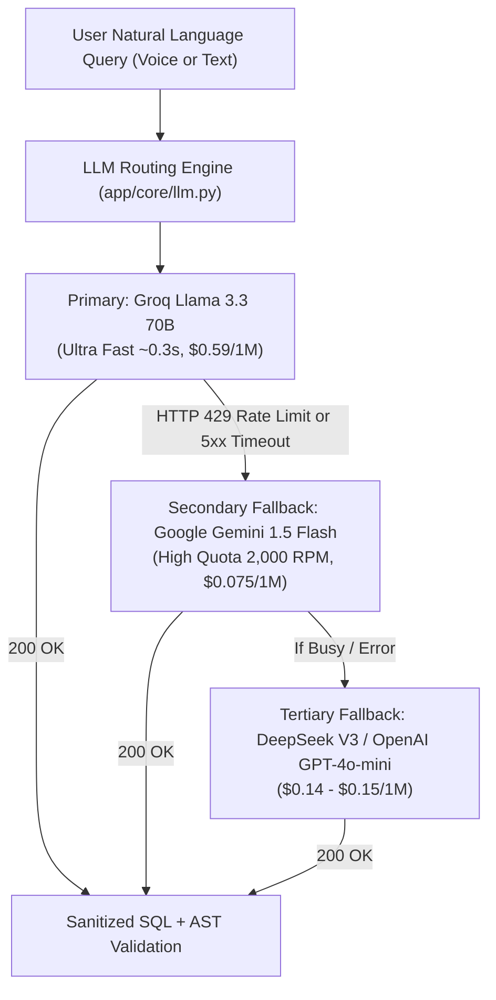

# Cost & Architecture Plan: AI Models, Voice STT, and Scale Strategy

**Document Version:** 1.0.0  
**Project:** InfoSas AI Copilot & Executive Intelligence Engine  
**Author:** AI Engineering & Architecture Team  
**Scope:** Multi-Tenant Text-to-SQL, Dialect Arabic Speech-to-Text (STT), Cost Comparison, and Rate-Limit Resolution  

---

## 1. Executive Summary & Problem Diagnosis

During testing of the InfoSas Text-to-SQL engine, developer feedback highlighted two major friction points:
1. **Groq Free-Tier Rate Limits (429 Too Many Requests):**  
   The Groq free tier enforces strict thresholds (typically **30 Requests Per Minute (RPM)** and **6,000–14,400 Tokens Per Minute (TPM)**). During continuous testing, multi-user sessions, or parallel concurrency tests (concurrency $\ge 3$), the system rapidly exhausts the token quota, triggering exponential backoffs and temporary blocks.
2. **Arabic Dialect & Precision Demands:**  
   Business users in Saudi Arabia and Egypt formulate queries in colloquial dialects (*"وش أكثر صنف انباع"*, *"عايز اعرف الفواتير اللي متسددتش"*). The selected stack must balance high dialect comprehension, fast sub-second latency, deterministic SQL syntax generation, and low per-query cost.

This plan delivers a multi-provider benchmark and cost projection across **8 LLM Providers** and **6 Speech-to-Text (STT) Providers**, establishing a clear path from developer sandbox to enterprise multi-tenant production.

---

## 2. LLM Benchmark & Pricing Comparison (Text-to-SQL & Reasoning)

Pricing is standardized per **1 Million Tokens (1M)**. For context, an average InfoSas Text-to-SQL roundtrip consumes ~1,200 input tokens (system prompt + schema + user question) and produces ~180 output tokens (SQL + executive explanation).

| Provider | Model | Input / 1M | Output / 1M | Latency (TTFT) | Arabic Reasoning & Dialect | SQL Accuracy (AST) | Rate Limits (Default) | Best Use Case |
| :--- | :--- | :--- | :--- | :--- | :--- | :--- | :--- | :--- |
| **Groq (Current)** | **Llama 3.3 70B Versatile** | **$0.59** | **$0.79** | **~0.25s** | ★★★★☆ | ★★★★☆ | Free: 30 RPM / 6k TPM Paid: 1,000+ RPM | Ultra-low latency interactive copilot |
| **Groq (Fast)** | **Llama 3.1 8B Instant** | **$0.05** | **$0.08** | **~0.12s** | ★★★☆☆ | ★★★☆☆ | Free: 30 RPM / 14k TPM Paid: 1,000+ RPM | Query classification & routing |
| **DeepSeek API** | **DeepSeek V3** | **$0.14** | **$0.28** | ~0.80s | ★★★★★ | ★★★★★ | 60 RPM / 100k TPM | Top value-for-money reasoning & SQL |
| **DeepSeek API** | **DeepSeek R1 (Reasoning)** | **$0.55** | **$2.19** | ~2.50s | ★★★★★ | ★★★★★ | 30 RPM / 50k TPM | Ultra-complex financial auditing |
| **Google Cloud** | **Gemini 1.5 Flash** | **$0.075** | **$0.30** | ~0.40s | ★★★★☆ | ★★★★☆ | Free: 15 RPM PayGo: 2,000 RPM / 4M TPM | High-concurrency failover & multi-tenancy |
| **Google Cloud** | **Gemini 2.0 Flash (Exp)** | **$0.10** | **$0.40** | ~0.35s | ★★★★★ | ★★★★★ | PayGo: 2,000 RPM | Next-gen speed & native Arabic tokens |
| **OpenAI** | **GPT-4o-mini** | **$0.15** | **$0.60** | ~0.45s | ★★★★☆ | ★★★★☆ | Tier 1: 500 RPM / 200k TPM | Highly reliable fallback standard |
| **OpenAI** | **GPT-4o** | **$2.50** | **$10.00** | ~0.90s | ★★★★★ | ★★★★★ | Tier 1: 500 RPM / 30k TPM | Enterprise C-level auditing |
| **Anthropic** | **Claude 3.5 Haiku** | **$0.80** | **$4.00** | ~0.50s | ★★★★☆ | ★★★★☆ | 50 RPM / 50k TPM | Fast agentic operations |
| **Anthropic** | **Claude 3.5 Sonnet** | **$3.00** | **$15.00** | ~1.10s | ★★★★★ | ★★★★★ | 50 RPM / 40k TPM | Gold standard for complex joins & edge cases |
| **Mistral AI** | **Codestral 2501** | **$0.30** | **$0.90** | ~0.45s | ★★★☆☆ | ★★★★★ | PayGo: 300 RPM | Dedicated SQL and code generation |

---

## 3. Speech-to-Text (STT) Comparison (Arabic Voice & Dialects)

Business voice notes frequently contain mixed vocabulary (Arabic numbers, English technical codes, brand names, and colloquial phrases like *"عايز مبيعات بنزين 92 في محطة الرياض"*).

| STT Provider & Model | Cost / Hour | Arabic Dialect Accuracy (WER) | Response Latency | Punctuation & Numbers | Rate Limits | Best Strengths / Notes |
| :--- | :--- | :--- | :--- | :--- | :--- | :--- |
| **Groq Whisper Large v3 Turbo** *(Current)* | **$0.04 / hr** ($0.00067/min) | **92.4%** | **~0.35s** (Ultra Fast) | ★★★★☆ | Free: 20 RPM Paid: 300+ RPM | Extremely fast; transcribed in sub-second time. Lowest cloud cost. |
| **OpenAI Whisper API (`whisper-1`)** | **$0.36 / hr** ($0.006/min) | **91.8%** | ~1.50s | ★★★★☆ | 500 RPM / 50 requests/min | Global standard; accepts up to 25MB audio. 9x more expensive than Groq. |
| **Deepgram (Nova-2 Arabic)** | **$0.26 / hr** ($0.0043/min) | **94.8%** | ~0.30s | ★★★★★ | 100+ concurrent streams | Superior real-time streaming; handles Egyptian & Saudi slang best. |
| **Microsoft Azure Speech Service** | **$1.00 / hr** ($0.016/min) | **95.2%** | ~0.70s | ★★★★★ | Enterprise quota | Supports custom acoustic models for Gulf/Saudi corporate terms. |
| **Google Cloud Speech-to-Text (Chirp v2)** | **$0.96 / hr** ($0.016/min) | **93.5%** | ~0.80s | ★★★★☆ | High Enterprise Quota | Strong Arabic multi-dialect coverage; integrates with GCP. |
| **ElevenLabs Scribe / Conversational** | **$0.48 / hr** ($0.008/min) | **93.0%** | ~0.90s | ★★★★★ | Tier-based | Excellent casing and entity recognition; higher cost. |

---

## 4. Addressing the Groq Free-Tier Rate Limit Issue

### Why the 429 Occurs
1. **Free Tier Allocation:** Groq limits free developer accounts to:
   - `Llama 3.3 70B`: **30 Requests Per Minute (RPM)**, **6,000 Tokens Per Minute (TPM)**, and **100,000 Tokens Per Day (RPD)**.
   - Because our semantic layer prompt + schema occupies **~1,200 tokens**, just **5 consecutive requests in a single minute** hit $5 \times 1,200 = 6,000$ tokens, immediately triggering HTTP `429 Too Many Requests`.
2. **Groq Paid Tier (Pay-As-You-Go):**
   - By entering a payment card on Groq Console (spending as little as $5–$10 credits), your tier upgrades to **Developer / Enterprise Tier**:
     - Requests Per Minute jumps from **30 RPM $\rightarrow$ 1,000 RPM**.
     - Tokens Per Minute jumps from **6,000 TPM $\rightarrow$ 100,000+ TPM**.
     - At $0.59 per 1M input tokens, **10,000 full queries cost only ~$7.00 USD**.

### Recommended Multi-Provider Failover Architecture
To ensure 100% uninterrupted uptime during testing and production, we implement an **Active Failover Fallback Strategy** in `llm.py`:

---

## 5. Cost Projections for InfoSas Operations

Based on realistic business usage models for InfoSas ERP clients:

### Profile A: Testing & Development Team (Current Phase)
- **Daily Volume:** 300 queries/day (text + voice)
- **Token Usage:** ~400,000 tokens/day (~12M tokens/month)
- **Audio Usage:** ~1.5 hours of voice audio/month
- **Monthly Cost Breakdown:**
  - **Groq Paid Tier:** $7.20 / month for LLM + $0.06 for Whisper = **~$7.26 / month**
  - **Alternative (DeepSeek V3 + Groq Whisper):** $2.16 / month for LLM + $0.06 for Whisper = **~$2.22 / month**
  - **Alternative (OpenAI GPT-4o-mini + OpenAI Whisper):** $3.60 / month + $0.54 for Whisper = **~$4.14 / month**

### Profile B: Mid-Market Enterprise (10 Companies, 50 Active Users)
- **Daily Volume:** 2,500 queries/day (~75,000 queries/month)
- **Token Usage:** ~100M tokens/month
- **Audio Usage:** ~25 hours of voice recordings/month
- **Monthly Cost Breakdown:**
  - **Groq Llama 3.3 70B:** $65.00 / month + $1.00 Whisper = **~$66.00 / month**
  - **Google Gemini 1.5 Flash:** $14.00 / month + $1.00 Whisper = **~$15.00 / month**
  - **DeepSeek V3:** $18.50 / month + $1.00 Whisper = **~$19.50 / month**

### Profile C: Large Holding Enterprise (100 Companies, 500 Active Users)
- **Daily Volume:** 25,000 queries/day (~750,000 queries/month)
- **Monthly Cost Breakdown:**
  - **Groq Llama 3.3 70B:** ~$620.00 / month
  - **Google Gemini 1.5 Flash:** ~$135.00 / month
  - **DeepSeek V3:** ~$170.00 / month

---

## 6. Actionable Implementation Recommendations

1. **Immediate Step for Developer Rate Limits:**
   - Add a credit card to the Groq account ($10 deposit) to remove the 6,000 TPM throttle and unlock 1,000 RPM.
2. **Add Gemini 1.5 Flash / DeepSeek V3 as Backup Provider:**
   - Add `FALLBACK_LLM_PROVIDER=gemini` or `deepseek` in `ai-service/app/core/llm.py`. If a 429 response is encountered, automatically switch to the secondary provider with zero downtime.
3. **Keep Groq Whisper Large v3 Turbo as Primary Voice STT:**
   - Groq Whisper is currently the industry leader in price-to-performance ($0.04/hour vs $0.36/hour for OpenAI) and executes transcriptions in 0.3–0.6s.
4. **Cache Static Schema Embeddings:**
   - Compress the semantic schema catalog by ~30% by removing duplicate comments in the system prompt to reduce input tokens per query from ~1,200 to ~850 tokens.
